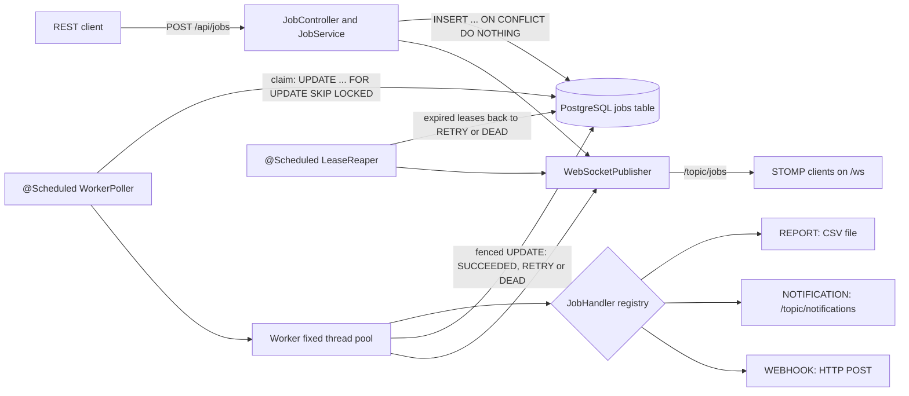
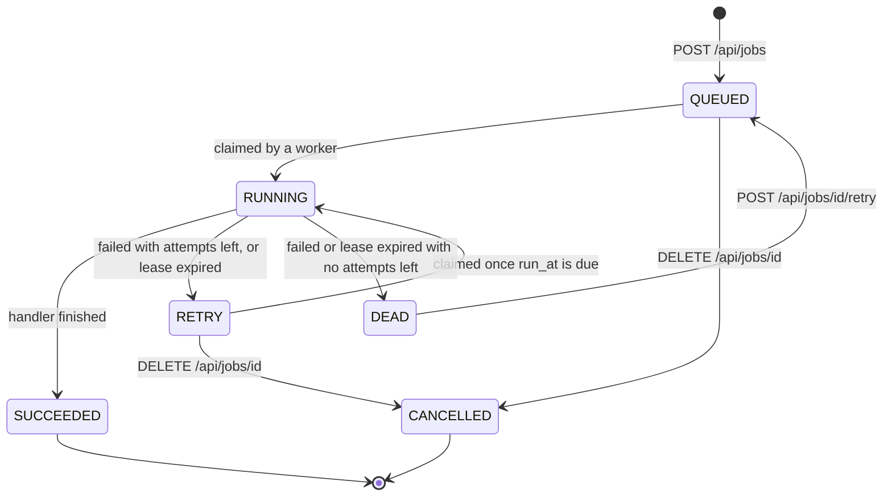

# TaskForge

TaskForge is a fault-tolerant background job engine built with Java 17 and Spring Boot 4, with PostgreSQL as the queue. It runs three job types: report generation (CSV files), notifications (WebSocket push) and webhooks (HTTP POST). Jobs can have priorities and scheduled run times. Multithreaded workers claim them concurrently with `FOR UPDATE SKIP LOCKED`. Failed jobs are retried with exponential backoff and jitter. Jobs that run out of attempts go to a dead-letter state. Jobs held by a crashed worker are recovered through leases, and submissions can be made idempotent with an `Idempotency-Key` header. A REST API manages jobs, and a STOMP-over-WebSocket feed streams every status change.

## Why

Most applications have work that should not run inside a web request. Examples: building a report, notifying users, calling a partner's webhook. That work needs to survive restarts, retry when a dependency is down, and never run twice just because two workers looked at the queue at the same moment. TaskForge does this with the database most applications already have, without a separate broker. The interesting parts are the correctness mechanisms: SKIP LOCKED claiming, leases, fencing and idempotency. A test suite on a real PostgreSQL checks each of them.

## Features and where they live

| Feature | Code (`src/main/java/com/shamanth/taskforge/...`) |
|---|---|
| 3 job types: `REPORT`, `NOTIFICATION`, `WEBHOOK` | `handler/ReportJobHandler`, `handler/NotificationJobHandler`, `handler/WebhookJobHandler`, looked up through `handler/JobHandlerRegistry` (a `Map<String, JobHandler>` built from the handler beans) |
| Priorities and scheduled runs (`priority`, `runAt`) | claim query in `job/JobRepository` |
| Multithreaded workers that claim jobs concurrently via SKIP LOCKED | `worker/Worker` (id + fixed thread pool), `worker/WorkerPoller` (`@Scheduled`), `JobRepository.claim` |
| Retries with exponential backoff and jitter, up to 5 attempts by default | `worker/BackoffPolicy`, `worker/JobExecutor` |
| Dead-letter queue (`DEAD`) with manual requeue | `JobExecutor`, `POST /api/jobs/{id}/retry` |
| Lease-based crash recovery | `worker/LeaseReaper`, `JobRepository.reapExpiredLeases` |
| Fencing of stale results | `JobRepository.markSucceeded` / `markRetry` / `markDead` |
| Idempotent submission | `Idempotency-Key` header, `JobRepository.insert` (`ON CONFLICT DO NOTHING`) |
| 6 REST endpoints with JSON errors | `api/JobController`, `api/StatsController`, `api/ApiExceptionHandler` |
| WebSocket status feed | `stream/WebSocketConfig`, `stream/WebSocketPublisher` |
| Configuration | `config/TaskForgeProperties` (`taskforge.*`) |

## Architecture



Job lifecycle:



Each `Worker` has an id and a fixed thread pool. On every tick, `WorkerPoller` claims up to as many jobs as the worker has free threads, publishes `RUNNING` and hands each job to a pool thread. `JobExecutor` runs the job's handler, then records the result with a fenced update. The application starts one worker. The concurrency test runs four of them in one JVM against the same table, which is how separate instances would share work.

## Claiming jobs with SKIP LOCKED

```sql
UPDATE jobs
SET status = 'RUNNING', locked_by = ?, locked_until = now() + (? * interval '1 second'),
    attempts = attempts + 1, updated_at = now()
WHERE id IN (
    SELECT id FROM jobs
    WHERE status IN ('QUEUED','RETRY') AND run_at <= now()
    ORDER BY priority DESC, run_at
    LIMIT ?
    FOR UPDATE SKIP LOCKED)
RETURNING *;
```

- The inner `SELECT` finds due jobs, highest `priority` first and the oldest `run_at` within a priority. Jobs with a future `run_at` are not touched. The `LIMIT` is the worker's number of free threads.
- `FOR UPDATE` locks the selected rows. `SKIP LOCKED` makes a concurrent claimer skip rows another transaction has already locked, instead of waiting for them. So workers never block each other and two workers can never lock the same row.
- Selection and update are one autocommit statement, so there is no gap between "pick" and "mark RUNNING". Under READ COMMITTED, a row that another worker has already committed as `RUNNING` is re-checked against the `WHERE` clause and dropped.
- The claim sets the lease (`locked_until`) using the database clock and counts the attempt immediately.
- The partial index `idx_jobs_claim ON jobs (priority DESC, run_at) WHERE status IN ('QUEUED','RETRY')` (migration `V2`) holds only claimable jobs, already in claim order. On a seeded table of 5,000 jobs, 650 of which were due (`QUEUED` or `RETRY` with a past `run_at`), `EXPLAIN ANALYZE` of the inner query with `LIMIT 8` showed an index scan on it, with `run_at <= now()` as the index condition and no sort step. It read 8 rows and stopped.
- With only `idx_jobs_ready (status, priority DESC, run_at)` from `V1`, the same query fetched all 650 due rows and sorted them before the `LIMIT`, because an index that starts with `status` cannot return two statuses in `priority` order. `idx_jobs_ready` is kept, because the lease reaper and the count behind `GET /api/jobs?status=` use it.

## Reliability

Retries with exponential backoff and jitter. When a handler throws and attempts are left, the job goes to `RETRY` with `run_at = now() + delay`:

```
delay(attempt) = min(maxDelay, baseDelay * 2^(attempt - 1) + jitter)
jitter         = random share of the exponential part, up to jitterRatio
```

The defaults are a 1 s base, a 5 min cap, 20 % jitter and 5 attempts. A job that keeps failing therefore waits about 1 s, 2 s, 4 s and 8 s (each plus up to 20 %) between attempts 1 to 5, and becomes `DEAD` after the fifth failure. Jitter spreads out retries of jobs that failed together, so a recovering dependency is not hit by all of them at the same moment. The cap is applied last, and the computation is overflow-safe for any attempt number.

Dead-letter queue. `DEAD` is the dead-letter state. `last_error` keeps the exception class and message (up to 2,000 characters). `GET /api/jobs?status=DEAD` lists dead jobs, and `POST /api/jobs/{id}/retry` puts one back to `QUEUED` with a fresh attempt budget (`attempts` is reset to 0). `last_error` is kept until the next failure.

Leases and crash recovery. A claim leases the job to one worker until `locked_until` (default 30 s). If the worker crashes, hangs or loses the database, the lease runs out. `LeaseReaper` runs every 10 s and moves such jobs back to `RETRY`, runnable immediately, or to `DEAD` if their attempts are used up. Because the attempt was counted at claim time, a job that keeps killing its worker still ends up `DEAD` instead of looping forever. `last_error` names the worker that lost the lease.

Fencing. Every completion and failure update is guarded:

```sql
... WHERE id = ? AND locked_by = ? AND attempts = ? AND status = 'RUNNING'
```

A worker that comes back after its lease expired cannot overwrite the state written by the reaper or by the worker that re-claimed the job. Its update matches no row, is rejected and logged. `locked_by` alone is not enough, because a worker can re-claim its own reaped job. `attempts` changes on every claim, so it tells the two claims apart.

Idempotent submission. `POST /api/jobs` accepts an optional `Idempotency-Key` header (1 to 100 characters), stored in the `UNIQUE` column `idempotency_key`. The insert uses `ON CONFLICT (idempotency_key) DO NOTHING RETURNING *`. A new key returns `201 Created`. A key that already exists returns `200 OK` with the original job; the replayed request body is not compared. Concurrent submissions with the same key create exactly one row, and a test covers this. A replay still uses up a value of the id sequence, so job ids can have gaps.

## REST API

| Method | Path | Success | Errors |
|---|---|---|---|
| `POST` | `/api/jobs` | `201 Created` with `Location`; `200 OK` when the `Idempotency-Key` already exists | `400` validation, unknown type, invalid payload, malformed JSON |
| `GET` | `/api/jobs/{id}` | `200 OK` | `404`, `400` for a non-numeric id |
| `GET` | `/api/jobs?status=&page=&size=` | `200 OK`, a page of jobs (newest first; `page` default 0, `size` 1 to 100, default 20) | `400` for an unknown status or bad paging |
| `POST` | `/api/jobs/{id}/retry` | `200 OK`, the job back in `QUEUED` | `404`; `409` unless the job is `DEAD` |
| `DELETE` | `/api/jobs/{id}` | `200 OK`, the job in `CANCELLED` | `404`; `409` unless the job is `QUEUED` or `RETRY` |
| `GET` | `/api/stats` | `200 OK`, the count per status plus `total` | |

Submit body fields:

- `type` (required): `REPORT`, `NOTIFICATION` or `WEBHOOK`, case-insensitive.
- `payload` (required): a JSON object, validated per type.
- `priority`: an integer, default 0; higher runs first.
- `runAt`: an ISO-8601 instant, default now.
- `maxAttempts`: 1 to 100, default 5.

Payloads by type:

| Type | Payload | What it does |
|---|---|---|
| `REPORT` | `{"name": "daily-sales", "columns": ["region", "amount"], "rows": [["north", 120]]}` | Writes `reports/<name>-<id>.csv` (RFC 4180 quoting, UTF-8). `name` is 1 to 64 letters, digits, `_` or `-`. |
| `NOTIFICATION` | `{"message": "Report ready"}` (up to 1,000 characters) | Pushes `{jobId, message, timestamp}` to `/topic/notifications`. |
| `WEBHOOK` | `{"url": "https://...", "body": {...}}` (`body` optional, default `{}`) | POSTs `body` as JSON with the header `Idempotency-Key: taskforge-job-<id>`. A non-2xx response or an I/O error fails the attempt, and the job is retried. |

Every error is JSON from one `@RestControllerAdvice`:

```json
{"timestamp":"2026-10-02T20:11:03.275131900Z","status":400,"error":"Bad Request","message":"Validation failed","path":"/api/jobs","fieldErrors":{"payload":"must not be null"}}
```

### PowerShell examples

Tested in Windows PowerShell 5.1 against a running instance. JSON bodies are single-quoted strings.

```powershell
# Same Idempotency-Key twice: 201 Created, then 200 OK with the same job
$body = '{"type":"REPORT","payload":{"name":"daily-sales","columns":["region","amount"],"rows":[["north",120],["south, east",95]]}}'
$headers = @{ 'Idempotency-Key' = 'daily-sales-2026-10-02' }
$first = Invoke-WebRequest -UseBasicParsing -Method Post -Uri http://localhost:8080/api/jobs -ContentType 'application/json' -Headers $headers -Body $body
$second = Invoke-WebRequest -UseBasicParsing -Method Post -Uri http://localhost:8080/api/jobs -ContentType 'application/json' -Headers $headers -Body $body
"$($first.StatusCode) then $($second.StatusCode)"
$id = ($first.Content | ConvertFrom-Json).id

# A worker picks it up within a poll interval
Start-Sleep -Seconds 2
Invoke-RestMethod "http://localhost:8080/api/jobs/$id"
Get-Content ".\reports\daily-sales-$id.csv"

# A notification scheduled one hour ahead with priority 5, then cancelled
$runAt = (Get-Date).ToUniversalTime().AddHours(1).ToString('o')
$later = Invoke-RestMethod -Method Post -Uri http://localhost:8080/api/jobs -ContentType 'application/json' -Body ('{"type":"NOTIFICATION","payload":{"message":"later"},"priority":5,"runAt":"' + $runAt + '"}')
Invoke-RestMethod -Method Delete "http://localhost:8080/api/jobs/$($later.id)"

# A webhook that calls TaskForge's own API (see "End-to-end idempotency" below)
$hook = Invoke-RestMethod -Method Post -Uri http://localhost:8080/api/jobs -ContentType 'application/json' -Body '{"type":"WEBHOOK","payload":{"url":"http://localhost:8080/api/jobs","body":{"type":"NOTIFICATION","payload":{"message":"Delivered by a webhook"}}}}'

# Dead-letter: every attempt gets a non-2xx response, maxAttempts 2
$bad = Invoke-RestMethod -Method Post -Uri http://localhost:8080/api/jobs -ContentType 'application/json' -Body '{"type":"WEBHOOK","payload":{"url":"http://localhost:8080/api/does-not-exist"},"maxAttempts":2}'
Start-Sleep -Seconds 4
(Invoke-RestMethod "http://localhost:8080/api/jobs?status=DEAD").items | Select-Object id, attempts, lastError
Invoke-RestMethod -Method Post "http://localhost:8080/api/jobs/$($bad.id)/retry"

# The job the webhook created carries the key taskforge-job-<webhook id>
(Invoke-RestMethod "http://localhost:8080/api/jobs?size=50").items | Where-Object { $_.idempotencyKey -eq "taskforge-job-$($hook.id)" } | Select-Object id, type, status, idempotencyKey

Invoke-RestMethod http://localhost:8080/api/stats | ConvertTo-Json

# Error bodies: Windows PowerShell 5.1 throws on 4xx/5xx, so read the response stream
try { Invoke-RestMethod http://localhost:8080/api/jobs/999999 } catch { (New-Object System.IO.StreamReader($_.Exception.Response.GetResponseStream())).ReadToEnd() }
```

End-to-end idempotency: the webhook handler sends `Idempotency-Key: taskforge-job-<id>`, and TaskForge's own `POST /api/jobs` honours that header. So the self-webhook above creates exactly one `NOTIFICATION` job, even if the webhook job itself is retried.

### curl examples (bash)

On Windows, run these in Git Bash (where they were tested) or WSL, or use the PowerShell examples above. In Windows PowerShell, `curl` is an alias for `Invoke-WebRequest`, so these lines do not work there as written.

```bash
curl -i -X POST http://localhost:8080/api/jobs \
  -H 'Content-Type: application/json' \
  -H 'Idempotency-Key: weekly-report-2026-w40' \
  -d '{"type":"REPORT","payload":{"name":"weekly","columns":["region","amount"],"rows":[["north",120]]}}'

curl -X POST http://localhost:8080/api/jobs \
  -H 'Content-Type: application/json' \
  -d '{"type":"WEBHOOK","priority":10,"maxAttempts":3,"payload":{"url":"http://localhost:8080/api/jobs","body":{"type":"NOTIFICATION","payload":{"message":"hello from a webhook"}}}}'

curl http://localhost:8080/api/jobs/1
curl 'http://localhost:8080/api/jobs?status=SUCCEEDED&page=0&size=2'
curl -X POST http://localhost:8080/api/jobs/1/retry      # 409 unless job 1 is DEAD
curl -X DELETE http://localhost:8080/api/jobs/1          # 409 unless job 1 is QUEUED or RETRY
curl http://localhost:8080/api/stats
```

## WebSocket feed

STOMP endpoint `ws://localhost:8080/ws` (plain WebSocket, no SockJS), with a simple in-memory broker on `/topic`. Clients can only subscribe; the server rejects client `SEND` and `MESSAGE` frames, the two frames that would publish to a topic (see Security notes). Every status change is published to `/topic/jobs`: submit, claim, success, retry, dead, reaper, retry endpoint and cancel.

Event order. Each status event is published by the thread that made the change, after its statement committed: `QUEUED` and `CANCELLED` by the HTTP request thread, `RUNNING` by the poller, a job's `SUCCEEDED`, `RETRY` or `DEAD` by the worker thread that ran it, and lease expiries by the reaper. Publishing preserves order per subscriber, and the poller publishes `RUNNING` before it hands the job to a worker thread, so a job's `RUNNING` arrives before the result of that attempt. Events from different threads can arrive out of order, though. A worker can claim a new job and publish `RUNNING` before the HTTP thread has published `QUEUED`. The retry endpoint's `QUEUED` and the reaper's `RETRY` can race with the next claim in the same way. A subscriber that tracks job state should therefore keep, per job `id`, the event with the newest `timestamp`. That `timestamp` is the job row's `updated_at`, returned by the statement that made the change (`RETURNING *`). It comes from the PostgreSQL clock (`now()`, the start time of that statement's transaction), not from the JVM. The `timestamp` of a `/topic/notifications` message is the JVM time at which the handler sent it.

| Topic | Message |
|---|---|
| `/topic/jobs` | `{"id":3,"type":"NOTIFICATION","status":"RUNNING","attempts":1,"timestamp":"2026-10-02T20:06:51.057587Z"}` |
| `/topic/notifications` | `{"jobId":3,"message":"Report daily-sales is ready","timestamp":"2026-10-02T20:06:51.061537Z"}` |

A dependency-free way to watch the feed: open `http://localhost:8080/api/stats` in a browser tab (the endpoint only accepts same-origin browser connections), open the developer console and paste:

```javascript
const ws = new WebSocket('ws://localhost:8080/ws');
ws.onopen = () => ws.send('CONNECT\naccept-version:1.2\nheart-beat:0,0\n\n\0');
ws.onmessage = (event) => {
  if (event.data.startsWith('CONNECTED')) {
    ws.send('SUBSCRIBE\nid:jobs\ndestination:/topic/jobs\n\n\0');
    ws.send('SUBSCRIBE\nid:notifications\ndestination:/topic/notifications\n\n\0');
    return;
  }
  const body = event.data.slice(event.data.indexOf('\n\n') + 2, event.data.lastIndexOf('\0'));
  console.log(JSON.parse(body));
};
```

These are raw STOMP 1.2 frames, each ending in a NUL byte. The same frames were checked against a running instance with a .NET `ClientWebSocket`. That check received `QUEUED`, `RUNNING`, the notification and `SUCCEEDED`, in that order. `JobStatusWebSocketTest` covers the feed with Spring's STOMP client.

## Configuration

| Property | Default | Meaning |
|---|---|---|
| `taskforge.worker.enabled` | `true` | Start the in-process worker and poller |
| `taskforge.worker.threads` | `8` | Worker threads, which is also the maximum number of jobs claimed per poll |
| `taskforge.worker.poll-interval` | `500ms` | Delay between polls |
| `taskforge.worker.lease` | `30s` | Lease per claim; must be longer than the longest job |
| `taskforge.retry.default-max-attempts` | `5` | Used when a request omits `maxAttempts` |
| `taskforge.retry.base-delay` | `1s` | Delay after the first failure |
| `taskforge.retry.max-delay` | `5m` | Backoff cap |
| `taskforge.retry.jitter-ratio` | `0.2` | Random extra delay, up to 20 % of the exponential part |
| `taskforge.reaper.enabled` | `true` | Run the lease reaper |
| `taskforge.reaper.interval` | `10s` | Reaper period |
| `taskforge.report.dir` | `reports` | Output directory for CSV reports (git-ignored) |
| `taskforge.webhook.connect-timeout` / `read-timeout` | `5s` / `10s` | Webhook HTTP timeouts |
| `server.address` | `127.0.0.1` | Interface the HTTP and WebSocket server listens on. `0.0.0.0` means all interfaces; there is no authentication, so use it only on a trusted network |
| `spring.datasource.url` | `jdbc:postgresql://localhost:5433/taskforge` | The compose database |
| `spring.datasource.username` / `password` | `taskforge` / `taskforge` | Local development only |

## Run locally

Requirements: Docker Desktop and a JDK 17 or newer. The project compiles with `--release 17`; it was built and tested with JDK 25. Maven is not needed, because the wrapper downloads it.

```powershell
docker compose up -d           # PostgreSQL 16 on localhost:5433
.\mvnw.cmd spring-boot:run     # API and WebSocket on http://localhost:8080
```

If `java -version` reports a JDK older than 17, point `JAVA_HOME` at a newer JDK for the session before running the wrapper:

```powershell
$env:JAVA_HOME = "C:\path\to\jdk-17-or-newer"
$env:Path = "$env:JAVA_HOME\bin;$env:Path"
```

Notes:

- The database is published on `127.0.0.1:5433` only. It uses port 5433 because 5432 is often taken by a locally installed PostgreSQL.
- The app listens on `127.0.0.1:8080` only, because it has no authentication. To accept connections from other machines, pass `--server.address=0.0.0.0`, for example `.\mvnw.cmd spring-boot:run "-Dspring-boot.run.arguments=--server.address=0.0.0.0"`. Anyone who can reach the port can then submit, cancel and retry jobs, so do this only on a trusted network.
- In Windows PowerShell 5.1, the first request to `http://localhost:8080` can pause for about 2 s. `localhost` resolves to `::1` first, the app does not listen there, and PowerShell tries `127.0.0.1` only after the IPv6 attempt fails. Use `http://127.0.0.1:8080` to avoid the pause.
- The app sets the JVM time zone to UTC at startup. PgJDBC sends the JVM time zone to the server, and current PostgreSQL images reject legacy zone IDs such as `Asia/Calcutta`.
- Flyway creates the `jobs` table on first start.
- To stop, press `Ctrl+C`, then run `docker compose down` (add `-v` to delete the data volume).

## Tests

```powershell
.\mvnw.cmd test
```

Docker must be running. The suite uses JUnit 6 (Jupiter), Testcontainers, AssertJ, Awaitility and MockMvc, and every database test runs against a real `postgres:16` container through `@ServiceConnection`. There are two Spring test contexts, each with its own container. In the "live" context, the app's own poller and reaper run with fast settings: 50 ms polls, a 5 s lease, a 250 ms reaper and 10 to 100 ms backoff. In the "manual" context, the poller and reaper are switched off, so tests drive claims, workers and the reaper themselves.

| # | Proves | Test |
|---|---|---|
| 1 | A `REPORT` job runs once, ends `SUCCEEDED` and writes the CSV | `JobLifecycleTest.reportJobSucceedsAndWritesCsv` |
| 2 | A job that fails twice succeeds on attempt 3 | `JobLifecycleTest.flakyJobSucceedsOnThirdAttempt` |
| 3 | An always-failing job with default settings ends `DEAD` after 5 attempts, with `last_error` set | `JobLifecycleTest.alwaysFailingJobIsDeadLetteredAfterFiveAttempts` |
| 4 | Backoff doubles, is capped, keeps jitter in bounds and never overflows | `BackoffPolicyTest` |
| 5 | The same `Idempotency-Key` twice gives one row, `201` then `200` with the same id; 8 concurrent submits with one key also give one row | `IdempotencyTest` |
| 6 | A higher-priority job is claimed first, then the older `run_at` | `ClaimQueryTest.claimsHigherPriorityFirst`, `samePriorityClaimsEarlierRunAtFirst` |
| 7 | A job with a future `run_at` is not claimed early | `ClaimQueryTest.doesNotClaimJobsScheduledInTheFuture` |
| 8 | An expired lease is requeued by the reaper and finished by another worker; on the last attempt it goes `DEAD` | `LeaseRecoveryTest` |
| 9 | A stale worker's completion is rejected, including the same worker's earlier claim | `FencingTest` |
| 10 | 4 workers × 8 threads (32 threads) process 5,000 jobs; each runs exactly once and ends `SUCCEEDED` | `ConcurrencyTest` |
| 11 | A STOMP client on `/topic/jobs` receives `QUEUED`, `RUNNING` and `SUCCEEDED` (`RUNNING` before `SUCCEEDED`), plus the notification | `JobStatusWebSocketTest.stompSubscriberReceivesStatusChangesAndNotifications` |
| 12 | The API returns `201`, `200` replay, `400`, `404` and `409`, and handles paging and stats | `JobApiTest` |
| | SKIP LOCKED skips a row locked by another transaction without blocking | `ClaimQueryTest.skipsRowsLockedByAnotherTransaction` |
| | A forged event that a client sends to `/topic/jobs` as a raw `SEND` or `MESSAGE` frame gets an `ERROR` frame and a closed connection and never reaches a subscriber, while server events still do | `JobStatusWebSocketTest.clientCannotPublishToTopics` |
| | The webhook POSTs the JSON body and `Idempotency-Key`; a `500` is retried, then dead-lettered | `WebhookJobHandlerTest` |
| | CSV escaping, overwrite on rerun, and rejection of unsafe report names | `ReportJobHandlerTest` |

Results on 2026-10-03 (Windows 11, 16 logical CPUs, Docker Desktop 29.3.1, JDK 25.0.2):

- The latest run of `.\mvnw.cmd test` had 45 tests: 0 failures, 0 errors, 1 skipped (the opt-in benchmark below), `BUILD SUCCESS`, total time 17.5 s. The concurrency test printed:

  ```
  CONCURRENCY jobs=5000 workers=4 threadsPerWorker=8 totalThreads=32 elapsedMs=1030 jobsPerSec=4854 executions[min=1,max=1,total=5000] duplicates=0 perWorker={worker-0=1340, worker-1=1247, worker-2=1270, worker-3=1143} distinctThreads=32
  ```

- Earlier full runs on 2026-10-02 and 2026-10-03 (40 to 45 tests as the suite grew) all had 0 failures, `duplicates=0` and `distinctThreads=32`.

In every run, every job ran exactly once (min = max = 1 execution, 0 duplicates), all 5,000 ended `SUCCEEDED` with `attempts = 1`, and all 32 worker threads did work. Wall-clock times varied a lot between runs on the same machine (0.9 s to 6.2 s for the 5,000 jobs, 16 s to 1 min 44 s for the whole build), so treat them as indicative only.

### Throughput benchmark (opt-in)

`ThroughputBenchmarkTest` is skipped by default. It seeds 2,000 jobs that each sleep about 5 ms, then drains them with 1 worker pool and then with 2 worker pools, each with 8 threads.

```powershell
.\mvnw.cmd test "-Dtest=ThroughputBenchmarkTest" "-Dtaskforge.benchmark=true"
```

Two runs on the machine above:

| Worker pools × threads | Run 1 | Run 2 |
|---|---|---|
| 1 × 8 | 245 jobs/s (8.2 s) | 243 jobs/s (8.2 s) |
| 2 × 8 | 473 jobs/s (4.2 s) | 505 jobs/s (4.0 s) |

A second pool roughly doubles throughput, because pools claim independently through SKIP LOCKED. The absolute numbers are well below the theoretical 8 threads ÷ 5 ms ≈ 1,600 jobs/s per pool. Every job costs a claim round trip and a completion round trip to PostgreSQL running in Docker Desktop, and the test loop sleeps 5 ms whenever it claims nothing. Read the table as a relative comparison, not as a capacity figure.

## Design trade-offs

- At-least-once delivery. A job can run more than once: a worker can die after the side effect but before its fenced update, or a job can outlive its lease. Fencing keeps the state consistent but cannot undo a side effect, so handlers have to be idempotent:
  - `REPORT` writes `<name>-<id>.csv` to a temp file and moves it into place atomically, so a rerun replaces the same file.
  - `WEBHOOK` sends `Idempotency-Key: taskforge-job-<id>` so receivers can deduplicate.
  - A `NOTIFICATION` may be delivered twice.
- PostgreSQL instead of Kafka or RabbitMQ.
  - Advantages: one system to run and back up, and jobs are ordinary rows you can query, update and fix with SQL. Because jobs are rows, an application sharing the database could enqueue in the same transaction as its business change (TaskForge itself submits through its API). SKIP LOCKED makes concurrent claiming cheap at moderate volume.
  - When to use a broker instead: Kafka suits very high event rates, many independent consumers, replay or long retention. RabbitMQ suits complex routing or push delivery with low latency.
- Polling. Latency is up to one poll interval (500 ms by default), and an idle poll is one indexed query. Each poll claims at most one job per free thread, so with the defaults a single worker starts at most 8 jobs per 500 ms. For many short jobs, lower `taskforge.worker.poll-interval`, raise `threads` or run more instances.
- Leases. There is no heartbeat, so the lease must be longer than the longest job. A job that runs past its lease can be started again by another worker. The first worker's late result is then rejected by fencing, but its side effect has already happened.
- Retention. Finished jobs are never deleted, so the table grows until a cleanup or partitioning step is added.

## Security notes

- There is no authentication or authorization. TaskForge is a local demo, so by default it binds to `127.0.0.1` (`server.address` in `application.properties`) and only accepts connections from the same machine. With `--server.address=0.0.0.0` it listens on all interfaces, and anyone who can reach port 8080 can submit, cancel and retry jobs. Do not expose it to an untrusted network. The loopback binding does not stop pages open in your own browser: a DNS-rebinding page, or a cross-site form POST to `/api/jobs/{id}/retry` (which takes no body), can still reach the API.
- Webhook URLs are not allow-listed. Anyone who can submit jobs can make the server POST to any host, including internal addresses (SSRF). Add an allow-list before exposing it.
- Report names are restricted to `[A-Za-z0-9_-]{1,64}`, so a payload cannot write outside the reports directory.
- The WebSocket endpoint relies on Spring's default same-origin check for browsers and has no authentication.
- WebSocket clients can only subscribe. The simple broker relays every client message of type `MESSAGE` to all subscribers of its destination, and a client can send one as a `SEND` frame or as a `MESSAGE` frame (normally a server-only frame). An interceptor on the client inbound channel (`WebSocketConfig`) therefore rejects every client message of that type: the client gets an `ERROR` frame and its connection is closed. Without it, a client could push a forged event on `/topic/jobs` or `/topic/notifications` to every subscriber. The server publishes through `SimpMessagingTemplate`, which does not pass through that channel.
- `compose.yaml` publishes PostgreSQL on `127.0.0.1:5433` only. Its credentials, and the ones in `application.properties`, are for local development only.

## Next steps

- Use `LISTEN/NOTIFY` to wake workers on new jobs instead of waiting for the next poll.
- Add lease heartbeats for long-running jobs.
- Add retention or partitioning for finished jobs.
- Add metrics (queue depth, claim latency, failures per type) with Micrometer.
- Add cron-style recurring jobs.
- Add authentication and a webhook allow-list.

## Project layout

```
src/main/java/com/shamanth/taskforge
├── TaskForgeApplication.java     entry point (forces UTC)
├── api/       JobController, StatsController, ApiExceptionHandler, request/response records
├── config/    TaskForgeProperties (taskforge.*), BackoffPolicy bean, SchedulingConfig
├── handler/   JobHandler interface, JobHandlerRegistry, Report/Notification/Webhook handlers
├── job/       Job, JobStatus, JobRepository (JdbcTemplate SQL), JobService
├── stream/    WebSocketConfig (STOMP /ws), WebSocketPublisher, event records
└── worker/    Worker, WorkerPoller, JobExecutor, BackoffPolicy, LeaseReaper, WorkerFactory
src/main/resources
├── application.properties
└── db/migration/   V1__create_jobs_table.sql, V2__add_claim_index.sql
src/test/java/com/shamanth/taskforge
├── AbstractIntegrationTest, AbstractManualWorkerTest, TestcontainersConfiguration
├── api/ handler/ job/ stream/ worker/   tests listed above
└── support/   test-only FLAKY, ALWAYS_FAIL and COUNTING handlers
compose.yaml                      PostgreSQL 16 on 127.0.0.1:5433
```
